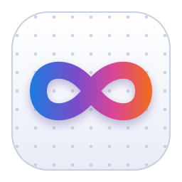

<p align="center">
  
</p>

<h1 align="center">无限画布 Ceres (infinite-canvas)</h1>

<p align="center">
  <a href="https://github.com/Shelios-Ceres/infinite-canvas"></a>
  <a href="LICENSE"></a>
  <a href="https://dotnet.microsoft.com/"></a>
  <a href="https://learn.microsoft.com/windows/apps/winui/winui3/"></a>
</p>

<p align="center">
  <a href="docs/content/docs/overview/quick-start.mdx">快速开始</a> · <a href="docs/content/docs/overview/features.mdx">功能介绍</a> · <a href="docs/content/docs/development/local-development.mdx">本地开发</a> · <a href="desktop/README.md">桌面客户端说明</a> · <a href="SECURITY.md">漏洞提交</a> · <a href="docs/content/docs/progress/todo.mdx">待办事项</a>
</p>

无限画布是一款面向图片创作的开源 Windows 桌面工作台，用 WinUI 3 原生编写。它把画布编排、AI 图片生成、图片工具、本机 Agent、提示词库和资料库放在同一个界面里，适合用来探索视觉方案并连续迭代图片结果。

本项目改自 [basketikun/infinite-canvas](https://github.com/basketikun/infinite-canvas)（MIT 许可），感谢原作者。原项目是网页版；这里改写成了 Windows 原生客户端，网页版及其配套已移除，需要时可以查看 git 历史或原仓库。

> [!CAUTION]
> 项目目前处于开发阶段，不保证历史数据兼容。各种本地存储格式都可能直接调整。

## 核心功能

- 无限画布：Win2D 画布，支持平移缩放、框选、连线、编组、小地图、撤销重做、拖入导入与自动保存。
- AI 创作：OpenAI、Google Gemini、火山方舟、xAI、千问五家按官方原生协议直连，支持图片、文本和语音生成，以及各家模型的特色编辑能力。
- 图片工具：局部编辑、裁剪、拆分、多角度重绘、反推提示词，以及用 Real-ESRGAN 在本机显卡上放大。
- 资料库与提示词库：每个画布有自己的资料库和「画布文件」页；提示词库保存在本机，所有画布共用。
- 本机 Agent：画布右侧的助手通过 ACP 接入 Claude Code、Kimi Code、Grok Build、DeepSeek Harness；客户端外的 Agent 可以通过 `--mcp-bridge` 操作当前画布。
- 本地优先：画布和媒体文件保存在本机，API Key 用 Windows DPAPI 加密保存。

完整功能说明见 [功能介绍](docs/content/docs/overview/features.mdx)。

## 快速开始

需要 Windows 10 1809 及以上（推荐 Windows 11）和 .NET 10 SDK。在仓库根目录执行：

```bash
dotnet build desktop/InfiniteCanvas.sln
```

```bash
desktop/src/InfiniteCanvas.App/bin/x64/Debug/net10.0-windows10.0.22621.0/win-x64/InfiniteCanvas.exe
```

首次打开后进入设置，在「服务商」里添加服务商并填入 API Key。更多说明见 [快速开始](docs/content/docs/overview/quick-start.mdx) 和 [桌面客户端说明](desktop/README.md)。

## 反馈

问题和建议请在 [GitHub Issues](https://github.com/Shelios-Ceres/infinite-canvas/issues) 提出；安全问题请按 [SECURITY.md](SECURITY.md) 私密报告。

## 开源协议

本项目使用 [MIT License](LICENSE)，并保留原作者的版权声明。任何人都可以免费使用、复制、修改、分发、再授权和商业使用本项目，也可以用于闭源产品。
