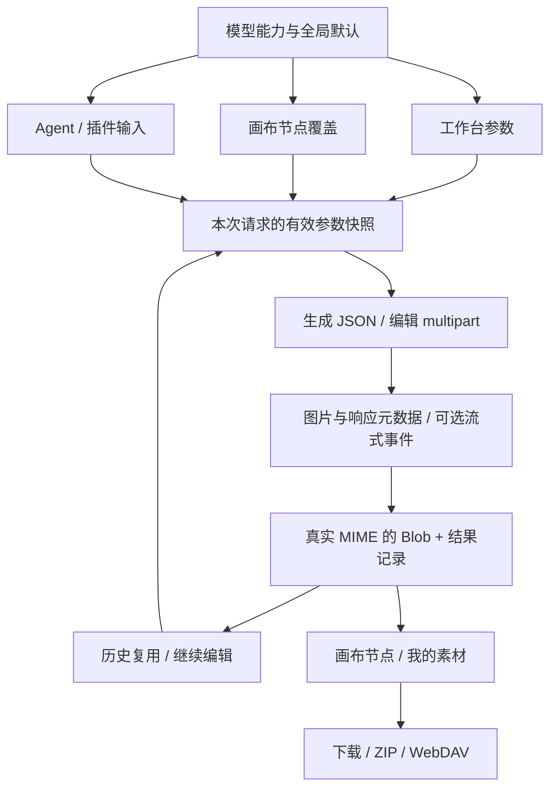

# GPT Image 2.5 API 深度适配调研

本报告面向 Infinite Canvas 的 OpenAI 官方直连适配。调研代码基线为 `main` 分支、提交 `d213a74`、版本 `v0.18.0`。接口差异来自 OpenAI 官方模型页、Images API 参考和图像指南；“当前实现”描述调研时的源码及本地生图工作台。第一阶段已进入实现与验收，实际变更见[待测试记录](/D:/infinite-canvas/docs/content/docs/progress/pending-test.zh-CN.mdx)；流式、input_fidelity 和 Responses 的实测条件继续适用。

建议沿用现有 Images API 完成生成和编辑的第一阶段适配，同时接入 Sunburst 与 Flare。优先补齐模型能力、质量、输出格式、原生遮罩和参数保存链路；流式预览与 Responses 多轮编辑分别实施。现有基础架构可继续使用，改动重点在参数能否从界面完整传到 API，以及返回结果能否准确保存和复用。

## 1. GPT Image 2 与 GPT Image 2.5 的区别

### 1.1 型号与接口

官方公开的 2.5 型号是 `gpt-image-2.5-sunburst` 和 `gpt-image-2.5-flare`，分别有 `2026-09-08` 日期快照。没有依据把未带后缀的 `gpt-image-2.5` 当作可请求的正式模型 ID。Sunburst 侧重编辑精度，Flare 侧重快速、高质量日常生成；两者都接受图片输入。[S1]、[S2]

| 比较项 | GPT Image 2 | GPT Image 2.5 | 对项目的影响 |
|---|---|---|---|
| 模型选择 | `gpt-image-2`；快照 `gpt-image-2-2026-04-21` | Sunburst / Flare 两个型号及日期快照 | 增加明确型号与用途说明，保留旧型号；不要用单一模糊名称替代 |
| 质量 | `auto / low / medium / high` | 增加 `xhigh / max` | 是本次明确新增的参数取值，UI、校验、请求、历史必须同步 |
| 生成与编辑端点 | `/v1/images/generations`、`/v1/images/edits` | 延续这两个端点 | 常规生成/编辑不必先迁到 Responses |
| 透明输出 | 当前接口参考标记为 preview | Sunburst、Flare 明确支持 | 背景控制应完整表达 `auto / opaque / transparent`，并与格式联动 |
| 自定义尺寸 | 支持合法的 `WIDTHxHEIGHT` | 继续支持 | 不是 2.5 新增；已有尺寸校验大部分可以保留 |
| PNG / JPEG / WebP、压缩 | 属于现有 GPT Image 接口能力 | 继续支持 | 是项目能力补齐，不能包装成 2.5 独有功能 |
| 多图输入、局部编辑 | 已有相关 API 能力 | 继续提供，并突出精确编辑工作流 | 重点检查项目是否真的传递原生参数 |
| Responses 图像工具 | 已有另一条接入路径 | 可在图像工具中指定两个 2.5 型号 | 适合对话式编辑，但需要独立处理工具调用结果 |

接口和参数依据：[Images 生成参考][S4]、[Images 编辑参考][S5]、[图像生成指南][S6]。Flare 模型卡没有列出编辑端点，但编辑参考明确列出 Flare，提示词指南也给出了 Flare 编辑示例；适配方案应支持其编辑入口，并在上线前实测，不能仅因模型卡漏项将其禁用。[S2]、[S5]、[S7]

### 1.2 尺寸与质量必须分开

当前官方指南给出的自定义尺寸边界为：宽高均为 16 的倍数；单边不超过 3840；长短边比不超过 3；总像素在 655,360 至 8,294,400 之间。标准推荐尺寸包括 `1024x1024`、`1536x1024`、`1024x1536`。超过 `2560x1440` 的分辨率被标记为实验性。`3840x2160` 是常见上限示例，不能把这句话理解成只允许横向尺寸或固定三个尺寸。[S4]、[S5]、[S6]

`xhigh`、`max` 描述质量，不代表“6K”“8K”，也不应自动改变宽高。项目已有的 `1k / 2k / 4k` 是预设分组，而不是 API 的独立参数。例如当前“4k + 1:1”实际为 `2880x2880`；界面必须显示最终像素值，不能承诺 `4096x4096`。[尺寸预设源码](/D:/infinite-canvas/web/src/lib/media-size.ts:15)

### 1.3 费用与返回值

两个 2.5 型号的公开 token 单价相同：每百万文本输入 token 为 5 美元，缓存文本输入为 1.25 美元；图片输入为 8 美元，缓存图片输入为 2 美元；图片输出为 30 美元。相同单价不等于每张图片价格相同，实际消耗会受型号、质量、尺寸及输入影响；不能沿用 Image 2 的固定每图估价表推算 2.5。[S1]、[S2]

项目应保存 API 返回的 `usage`，在存在可核对的 token 明细时计算估算费用。一次 `n > 1` 请求的 usage 是请求级信息，不能伪装成每张图片都有独立实测账单。若采用 Responses，还要单独计入主模型用量。[S6]、[S9]

## 2. 当前实现的关键缺口

这些是源码已经确认的行为，不依赖对 2.5 运行结果的猜测。

| 现有行为 | 直接后果 | 源码位置 |
|---|---|---|
| `normalizeQuality` 只认可 `low / medium / high / standard / hd` 及旧分辨率别名 | 即使 UI 写入 `xhigh` 或 `max`，请求层也会丢弃它们，实际退回服务端默认质量 | [image.ts](/D:/infinite-canvas/web/src/services/api/image.ts:100) |
| 内建请求固定 `output_format: "png"`，base64 解析固定加 `data:image/png` | 只新增 JPEG/WebP 下拉框仍然不够；请求、Blob 类型及下载扩展名可能不一致 | [请求常量](/D:/infinite-canvas/web/src/services/api/image.ts:118)、[响应解析](/D:/infinite-canvas/web/src/services/api/image.ts:243) |
| 背景只转发 `transparent`，其余值被省略 | 无法明确请求 `opaque`；关闭开关并不等于明确发送不透明背景 | [背景规范化](/D:/infinite-canvas/web/src/services/api/image.ts:129) |
| “遮罩编辑”提交原图和一张蓝色覆盖图作为两张参考图 | 没有 `mask` 字段，属于视觉提示编辑，不能等同原生透明通道遮罩 | [遮罩输出](/D:/infinite-canvas/web/src/components/canvas/canvas-node-mask-edit-dialog.tsx:419)、[调用方](/D:/infinite-canvas/web/src/pages/canvas/project.tsx:1945) |
| 通用请求层把数量限制在 1–15，而官方单请求 `n` 上限是 10 | 调用方可构造超出官方限制的请求；不能依赖一个界面的按钮上限兜底 | [请求数量](/D:/infinite-canvas/web/src/services/api/image.ts:723)、[官方范围][S4] |
| 工作台批量创建多个并行任务，每个任务的快照固定 `count: "1"` | “生成 10 张”实际是 10 次请求；修改 API 的 `n` 不会自动改变工作台批量策略 | [批量调度](/D:/infinite-canvas/web/src/pages/image/index.tsx:176)、[请求快照](/D:/infinite-canvas/web/src/pages/image/index.tsx:307) |
| 历史快照只保存模型、质量、尺寸、数量，已经漏掉背景 | 复用历史无法完整还原原请求；新格式、压缩等也会继续丢失 | [历史类型](/D:/infinite-canvas/web/src/pages/image/index.tsx:43)、[快照构造](/D:/infinite-canvas/web/src/pages/image/index.tsx:819) |
| 图像返回类型和解析只保留图片列表 | 实际质量、尺寸、格式、usage 等元信息被丢弃，无法解释 `auto` 最终使用了什么 | [返回类型](/D:/infinite-canvas/web/src/services/api/image.ts:77)、[解析](/D:/infinite-canvas/web/src/services/api/image.ts:253) |
| OpenAI 自定义脚本模板仍无条件发送 `response_format: "b64_json"` | 官方 GPT Image 不接受该字段，模板与内建请求行为不一致 | [模板](/D:/infinite-canvas/web/src/services/api/model-plugin.ts:226)、[官方限制][S4] |
| 图像与视频共用部分全局尺寸字段；旧比例尺寸换算还依赖质量 | 高质量选项、不同媒体工作台和 Agent 写入之间可能发生设置串用 | [配置类型](/D:/infinite-canvas/web/src/stores/use-config-store.ts:27)、[尺寸换算](/D:/infinite-canvas/web/src/services/api/image.ts:134)、[Agent 视频设置](/D:/infinite-canvas/web/src/lib/agent/agent-site-tools.ts:223) |

已有能力可以复用：模型渠道选择、授权请求头、生成/编辑分流、多图上传、AbortSignal 取消、Blob/localforage 保存、画布连线、参考图顺序、工作台逐张结果槽位、ZIP/WebDAV 的媒体打包。无需为了这次接入先更换数据库或新增 SDK。

## 3. 参数与功能适配清单

### 3.1 第一阶段应完成的请求契约

| 参数/能力 | 官方取值或语义 | 项目应如何接入 |
|---|---|---|
| `model` | 两个完整 2.5 型号及其日期快照 | 识别精确 ID；模型选择器展示用途；旧模型继续使用自己的能力集合 |
| `prompt` | 生成/编辑提示词；GPT Image 文档上限 32,000 字符 | 保留原始输入与实际发送文本；长度校验应涵盖系统提示、参考图标签等拼接后的最终内容 |
| `quality` | 2.5：`auto / low / medium / high / xhigh / max`；2：仅前四档 | 按具体型号驱动 UI、规范化、工作台/节点快照和 Agent；避免从质量推导输出分辨率 |
| `size` | `auto` 或合法 `WIDTHxHEIGHT` | 保留 W/H、比例与预设；统一校验；准确显示请求尺寸和返回尺寸 |
| `n` | 单次请求 1–10 | 修正请求层范围；将单请求数量与工作台批量任务数分开建模 |
| `background` | `auto / opaque / transparent`；2.5 正式支持透明，2 的透明仍为 preview | 二态开关改三态；明确显示继承值与型号支持状态；与格式做条件校验 |
| `output_format` | `png / jpeg / webp` | 增加格式选择；请求、响应 MIME、Blob、下载扩展名贯通 |
| `output_compression` | 0–100，适用于 JPEG/WebP；生成参考的默认值为 100 | 仅在对应格式下展示并发送；用“压缩参数”加数值描述，不写“减少 X% 文件大小”等未证实含义 |
| `moderation` | `auto / low` | 放在高级设置，默认 `auto`；不描述为关闭过滤 |
| 编辑图像输入 | JSON 契约为 `images[]`，最多 16 个图像引用；也有 multipart 示例 | 现有本地 Blob 流程优先沿用 multipart；固定原图/参考图顺序，预检输入数和所选上传方式的限制 |
| `mask` | 独立编辑遮罩 | 作为单次编辑输入传递，不能混入普通参考图；从笔画生成真实 alpha mask |
| 返回 `background / quality / size / output_format` | 实际输出配置 | 单独保存“请求参数”和“实际结果”，尤其处理 `auto` |
| 返回 `usage` | 可选 token 明细 | 原样保留可用字段；未返回时显示未知，不填 0，不据此阻断图片保存 |
| 错误信息 | HTTP 状态、结构化错误和请求 ID | 保存可读原因及可用请求 ID；区分参数错误、权限/额度、限流、内容被拦截和网络错误 |

本表参数依据：[生成参数 schema][S8]、[编辑参考][S5]、[响应 schema][S9]。这里大多数是项目未接入的现有 API 能力，明确属于 2.5 增量的主要是型号、质量新档位和透明背景支持状态。

### 3.2 原生编辑与输入格式

推荐在现有 multipart 请求中增加独立 `mask` 文件，继续用 `image` / `image[]` 传原图和参考图。API 参考同时公开了 JSON 形式的 `images: [{ image_url | file_id }]` 与 `mask: { image_url | file_id }`；这是另一种序列化契约，不能把 JSON 的字段名直接塞进当前 FormData。[S5]

对本地工作台而言，先把 Blob multipart 链路做完整即可。只有明确需要远程 URL 或 Files API 资源复用时，再增加 JSON/文件 ID 输入；不要求为每张本地图像先上传到 Files API。

局部编辑应保证：遮罩尺寸与目标原图匹配；保留 alpha 通道；透明区域表达待编辑区域；多图时明确遮罩对应的主图。画笔的蓝色覆盖层仍可作为操作预览，但导出的 API 遮罩不能包含蓝色可视化涂层。原图、遮罩与额外参考图应有不同角色和持久化引用。[S6]

输入大小按实际传输路径校验。JSON 参考对 `image_url` 给出的是字符串长度限制，不能误当成文件字节上限；multipart 的图像/遮罩格式及大小应对照对应请求定义。实施时把这些条件写在各自的序列化入口，避免一个“最大文件大小”常量覆盖所有路径。[S5]

### 3.3 需要验证后开放的选项

`input_fidelity`：当前编辑参考列出 `high / low`，但指南明确要求 GPT Image 2 省略此字段，因其输入已固定高保真。对于 2.5，没有同样清晰的型号级说明。它不是已证实的“2.5 新增保真度滑块”。建议第一阶段省略，待分别验证两个 2.5 型号的参数接受情况和实际效果后，再决定是否加入高级编辑设置。[S5]、[S6]

流式：Images API 参考有 `stream`、`partial_images: 0–3` 和生成/编辑事件；模型卡却显示 Streaming 不支持。可设计独立的流式传输适配和渐进预览，但应以最小真实请求验证每个型号后启用，第一阶段保留非流式主路径。[S1]、[S2]、[S10]、[S11]

不要凭其它绘图系统经验新增 `seed`、`steps`、`cfg_scale`、`sampler`、`denoise_strength`、独立 `negative_prompt` 等未被当前契约支持的参数。风格、保持不变的内容、局部修改要求可以作为可编辑的提示词辅助，不应伪装成 API 字段。现有 `standard / hd`、`style: vivid / natural` 也不应作为 GPT Image 2.5 的质量/风格枚举。[S8]

### 3.4 Responses 应作为独立扩展

Images API 足以实现单次生成、参考图编辑和局部编辑。用户若需要“连续对话、在上一轮结果上继续改图”，再接入 Responses 的 `image_generation` 工具更合适。[S6]

Responses 顶层 `model` 是支持图像工具的主模型；`tools[].model` 才是 Sunburst/Flare。不能把 `gpt-image-2.5-sunburst` 直接填入现有文本 Responses 的顶层模型位置。

现有 `ResponseApiOutputItem` 只处理消息和函数调用，没有 `image_generation_call`。实施该扩展时需要处理图像工具结果、response/item ID、跨轮上下文、实际使用的提示词及相应流式事件。复用工作台结果图作为下一次 Images 编辑输入，也能先提供逐步改图体验；这与服务器保存的 Responses 对话状态应明确区分。[当前输出类型](/D:/infinite-canvas/web/src/services/api/image.ts:62)

## 4. UI 调整方案

### 4.1 保留整体布局，统一参数来源

保留当前桌面工作台的历史、创作、结果结构；窄屏继续使用现有历史/参数抽屉。保留画布主题和“全局默认 + 节点覆盖”，扩展已经共享的 `ImageSettingsPanel`。

建议增加一个小型模型能力模块，例如 `web/src/lib/image-model-capabilities.ts`，供参数 UI、请求校验及 Agent 参数处理共用。它只描述当前明确需要的型号、质量枚举、合法尺寸、格式/背景关系和已验证能力，不扩展成通用插件配置框架。该文件是建议落点，目前尚未创建。

### 4.2 生图工作台

| 区域 | 建议变化 | 用户能获得什么 |
|---|---|---|
| 模型行 | 展示完整型号，附“快速生图 / 精确编辑”用途说明；按任务推荐但不静默换模型 | 清楚当前实际调用哪个模型 |
| 提示词 | 保留自由输入；可选补充“本次修改”“保持不变”“图片用途”等提示词辅助 | 更方便表达局部编辑和版式要求 |
| 参考图 | 区分主图、参考图；允许调整顺序；局部编辑单独显示遮罩 | 避免主图和遮罩关系不明确 |
| 质量 | 六档：自动、低、中、高、超高 `xhigh`、最高 `max`；窄屏换行 | 高档位可见，且不挤占画布主体 |
| 尺寸 | 同时展示预设、比例和实际 W×H；官方模式始终按 16 倍数规则校验 | 选择前就能知道最终尺寸是否合法 |
| 背景/格式 | 背景三态；格式 PNG/JPEG/WebP；透明时不允许 JPEG | 避免提交必然冲突的组合 |
| 张数 | 保留“生成张数”的用户语言；逐张进度、成功/失败分别展示 | 保留已有单张重试体验 |
| 高级设置 | 折叠输出压缩、moderation；经验证后再加入保真度和流式预览 | 常用界面保持简洁，专业参数可访问 |

推荐模型策略：新建普通生成可推荐 Flare；参考图和局部编辑可推荐 Sunburst。先保留一个明确选择的模型，加推荐切换操作即可。为“生成”和“编辑”分别设默认模型是可选产品增强，不是 API 接入的必需条件。[S1]、[S2]

窄屏参数摘要建议为可换行的两行：第一行“型号 · 生成/编辑”，第二行“质量 · 实际尺寸 · 张数 · 格式”。参数抽屉继续使用同一组件，常用项默认展开，高级项折叠；不要维护另一套移动端默认值和选项表。

### 4.3 画布节点与局部编辑

画布参数弹层展示当前有效值，并区分“继承全局”与“节点已覆盖”。复制节点、重新生成、连接上游参考图时，都应使用该节点的完整参数快照。新增字段不只传到表单，还要传到配置节点、结果节点、重试与导出链路。

遮罩对话框可以保留现有画笔、擦除、撤销/重做和缩放工具。在提交区增加紧凑执行摘要：型号、质量、输出尺寸、格式；通过已有共享设置组件展开调整。遮罩的像素尺寸必须跟随原图，输出尺寸则独立决定：只有原图尺寸满足输出边界时才直接沿用，否则显示合规候选供选择，不能把任意原图宽高直接发给 `size`。

“导出到画布”应生成明确的原图—遮罩—编辑配置关系；“立刻生成”则在同一关系基础上执行。原图和最终结果保留为独立节点，便于继续编辑和回看。

### 4.4 结果、历史和素材

结果预览使用完整比例展示，透明图显示棋盘底。当前工作台图片使用正方形裁切，会隐藏横图和竖图的部分构图；输出尺寸和透明背景成为重要选择后，应修正这个直接影响验收的展示方式。[结果卡](/D:/infinite-canvas/web/src/pages/image/index.tsx:589)

结果主信息显示实际 W×H、格式、文件大小；次级详情展示模型、请求质量、实际质量、背景、操作类型、耗时以及可用 usage。下载扩展名由实际 MIME 决定，尤其处理 Blob URL 本身没有扩展名的情形。

历史必须保存完整有效参数以及实际返回元数据。现有点击历史会同时覆盖全局配置；建议把“预览历史”和“复用提示词与参数”做成两个明确动作。该交互分离属于建议，必需部分是恢复参数时不能漏掉背景、格式、压缩和遮罩关系。[历史选择](/D:/infinite-canvas/web/src/pages/image/index.tsx:295)

### 4.5 流式界面与 Agent

若型号实测支持流式，现有结果槽位可显示“等待 / 生成中 / 阶段预览 / 完成 / 失败 / 已取消”。阶段图只更新当前任务的预览，完成后再写入正式历史和素材；不要把每一张 partial 当作一张新作品，也不要从 partial 数量推导虚假的完成百分比。

Images 生成事件为 `image_generation.*`，编辑事件为 `image_edit.*`；Responses 则为 `response.image_generation_call.*`，字段也不同。传输层需要分别解析，再映射到同一 UI 状态。[S10]、[S11]

Agent 面板继续使用共享参数工具，不新增重复表单。读取配置应返回完整有效参数，生成工具应使用同一模型校验，并在操作结果中显示实际应用的型号/质量/尺寸/格式。异步派发任务应携带参数快照，避免排队期间全局设置变化导致执行内容漂移。

## 5. 必须联动的代码与数据链路

| 改动面 | 实施时涉及的位置 | 必须同步的原因 |
|---|---|---|
| 模型、类型、默认配置 | [use-config-store.ts](/D:/infinite-canvas/web/src/stores/use-config-store.ts:27)、[image.ts 类型](/D:/infinite-canvas/web/src/types/image.ts:1)、[canvas.ts](/D:/infinite-canvas/web/src/types/canvas.ts:47) | 新参数需要持久化；区分模型支持范围及节点覆盖 |
| 图片请求与响应 | [services/api/image.ts](/D:/infinite-canvas/web/src/services/api/image.ts:723) | 质量过滤、n 上限、输出格式、mask、结构化结果都汇聚于此 |
| 共用参数组件与型号选择 | [ImageSettingsPanel](/D:/infinite-canvas/web/src/components/image-settings-panel.tsx:22)、[画布弹层](/D:/infinite-canvas/web/src/components/canvas/canvas-image-settings-popover.tsx:77)、[ModelPicker](/D:/infinite-canvas/web/src/components/model-picker.tsx:21) | 工作台和画布不能各自维护不同质量、背景或格式选项 |
| 工作台生成、历史与下载 | [pages/image/index.tsx](/D:/infinite-canvas/web/src/pages/image/index.tsx:150) | 批量、失败重试、快照、真实格式和 usage 要贯通 |
| 画布参数构造与节点元数据 | [canvas-generation-helpers.ts](/D:/infinite-canvas/web/src/lib/canvas/canvas-generation-helpers.ts:96)、[canvas-node-factory.ts](/D:/infinite-canvas/web/src/lib/canvas/canvas-node-factory.ts:43) | 只改全局配置会在节点生成或再生成时丢参数 |
| 原生遮罩 | [mask-edit-dialog](/D:/infinite-canvas/web/src/components/canvas/canvas-node-mask-edit-dialog.tsx:206)、[project.tsx](/D:/infinite-canvas/web/src/pages/canvas/project.tsx:1945) | 从视觉覆盖图改为可重用的独立 alpha mask 输入 |
| MCP 与前端 Agent 工具 | [canvas-agent schemas](/D:/infinite-canvas/canvas-agent/src/canvas/schemas.ts:68)、[agent-site-tools.ts](/D:/infinite-canvas/web/src/lib/agent/agent-site-tools.ts:149)、[任务派发 store](/D:/infinite-canvas/web/src/stores/use-workbench-agent-store.ts:3) | 当前接口连背景都未完整暴露；工具和 UI 应使用同一份参数规则 |
| Canvas 插件 SDK/宿主 | [canvas-plugin.ts](/D:/infinite-canvas/web/src/types/canvas-plugin.ts:11)、[use-plugin-host.tsx](/D:/infinite-canvas/web/src/pages/canvas/hooks/use-plugin-host.tsx:53) | 宿主 `generateImage` 当前只暴露部分参数；若插件需要新能力，应同步扩展契约 |
| 自定义调用脚本 | [model-plugin.ts](/D:/infinite-canvas/web/src/services/api/model-plugin.ts:226) | 修正官方模板的 `response_format`；扩展宿主参数；已有用户脚本不能被批量覆盖 |
| Blob、素材、导出与同步 | [image-storage.ts](/D:/infinite-canvas/web/src/services/image-storage.ts:28)、[use-asset-store.ts](/D:/infinite-canvas/web/src/stores/use-asset-store.ts:9)、[canvas-export.ts](/D:/infinite-canvas/web/src/lib/canvas/canvas-export.ts:11)、[app-sync.ts](/D:/infinite-canvas/web/src/services/app-sync.ts:84) | 保持真实 MIME、遮罩存储引用和完整生成来源；导入后还能复用 |
| 文案与正式功能文档 | [中文语言资源](/D:/infinite-canvas/web/src/i18n/locales/zh-CN.ts:134)、对应英文资源、功能/待测文档 | 新质量档位、格式、参数摘要、错误说明与实际能力一致 |

已有 ZIP/WebDAV 流程会序列化记录并打包 Blob，可继续使用。应重点检查新字段是否在构造历史/节点时被挑选遗漏，以及新增遮罩 storage key 是否纳入导出资源收集；无需仅因增加几个参数启动存储系统迁移。

图片与视频的尺寸设置应在有效参数快照中按媒体类型分开；本次不需要重做视频工作台。官方 GPT Image 的能力规则也不能意外改变 Gemini 或用户自定义渠道的请求语义。

## 6. 实施顺序与验收

### 阶段一：可靠的官方 Images 接入

1. 引入小型模型能力定义，补齐两个 2.5 型号与六档质量；将质量与尺寸独立处理。
2. 修正官方请求参数、单请求 `n` 上限、背景/格式条件；扩展结构化响应与真实 MIME。
3. 贯通共享 UI、工作台快照、画布节点、历史恢复和下载；同步更新 MCP/插件中实际暴露的新字段。
4. 修正官方自定义脚本模板，保持旧模型及其它渠道行为不受影响。
5. 完成原生遮罩请求与遮罩资源的保存/再生成/导出链路。

本阶段即可形成完整的文生图、参考图编辑、原生局部编辑体验。实现可沿用现有 axios、fetch、localforage 和画布组件。

### 阶段二：渐进预览与用量反馈

分别验证 Sunburst/Flare 的生成流与编辑流，再增加流式消费、阶段图更新、取消和完成事件处理。费用展示依据实测返回字段落地；usage 缺失时仍能完成正常生成。

保持工作台逐张任务与单请求多图这两种概念清楚。任何并发数、自动重试次数或超时边界的改变，都应在实施前明确默认值与失败策略。本次调研不指定未经确认的并发上限，也不把 GPT Image 2 的账户配额当成 2.5 的固定配额。

### 阶段三：Responses 多轮编辑

在需要服务器侧对话上下文时，新增图像工具请求、结果类型和多轮状态管理。它可以与现有 Images 编辑并存；不能把当前文本流解析器直接视作图像工具解析器。

### 建议验收用例

| 验收面 | 有效证据 |
|---|---|
| 两型号与六档质量 | 请求记录确认完整模型 ID 和 quality 未被改写或丢弃；分别覆盖 `xhigh / max / auto` |
| 尺寸 | 标准横/竖/方图、自定义合法尺寸、非法 16 倍数、超边长/比例/像素范围；改变质量不改变已选尺寸 |
| 背景与格式 | PNG 透明、WebP 透明、JPEG 不透明；非法 JPEG+透明组合提交前明确提示；下载 MIME/扩展名与真实文件相符 |
| 编辑输入 | 单图、多图、16 图边界、超限输入；原图/参考图顺序不丢失 |
| 遮罩 | 请求存在独立 mask；alpha 极性和尺寸正确；蓝色覆盖图不作为 API mask；画布重开、导出导入后可复用 |
| 数量与批量 | 单请求 `n` 不超过 10；工作台多个结果槽位保持成功/失败归属，单张重试不重复覆盖已成功结果 |
| 参数持久化 | 全局—节点覆盖—重试—历史复用—ZIP/WebDAV 往返后，格式、背景、压缩、质量和遮罩关系保持一致 |
| Agent/插件 | 读取配置与实际执行一致；任务派发后改变全局设置不会污染已派发请求 |
| 流式 | 两种 Images 事件和 Responses 事件分开覆盖；收到较少 partial、断流、取消、最终完成均有确定状态 |
| 异常 | 参数错误、权限/额度、429、内容拦截、网络错误可区分；错误记录不包含 API Key 或整段图片 base64 |
| 用量 | 请求级 usage 原样保存；无 usage 不显示 0 成本；Responses 主模型费用与图像费用分开 |
| 回归 | 旧 `gpt-image-2` 不出现 `xhigh/max`；其它渠道、普通图片上传与现有画布数据仍可使用 |

以上是实施验收计划，不是本轮已通过的测试结果。本轮结论已具备文档和源码依据；账号访问权限、型号实际延迟、效果与付费额度仍需实施阶段的小规模真实请求验证。

## 7. 官方文档不一致处的处理

| 不一致处 | 当前可以确定什么 | 实施决策 |
|---|---|---|
| 模型卡显示 Streaming 不支持，端点/事件指南描述流式 | 事件契约存在，但型号级可用性描述冲突 | 非流式作为第一阶段主路径；逐型号验证后开启流式 |
| Flare 模型卡未列 edits | 编辑参考明确列 Flare，提示词指南有 Flare 编辑示例 | 支持编辑设计并加入型号实测，不判定“Flare 只能文生图” |
| `input_fidelity` 通用 schema 与 Image 2 的专门指南不同 | Image 2 指南明确要求省略；2.5 型号级描述不足 | 先省略，独立验证 2.5 后决定是否暴露控件 |
| usage 的部分 schema 描述仍写 `gpt-image-1 only` | 2.5 指南要求按 usage 观察成本，事件结构也包含 usage | 以可选元数据保存，不能保证每条响应都有，也不能丢弃已有数据 |
| Responses 工具的部分枚举未同步 2.5 | 型号页与指南明确支持工具中指定 2.5 | 独立验证工具型号、新质量档、动作和事件；不为绕过旧枚举而降档或换模型 |

## 8. 来源与证据范围

官方资料核验于 2026-09-14。所有接口边界都应在实施时继续以当前官方契约和目标账号实测为准。文档中“当前实现”对应本报告开头的 Git 基线；本地生图工作台已查看，包括约 628px 的窄屏布局，画布遮罩与 Agent 链路主要依据源码。

1. [GPT Image 2.5 Sunburst 模型页][S1]：型号、用途、质量、快照、价格。
2. [GPT Image 2.5 Flare 模型页][S2]：型号、用途、质量、快照、价格及模型卡差异。
3. [GPT Image 2 模型页][S3]：旧型号基线。
4. [Images API：Create image][S4]：生成端点与参数。
5. [Images API：Create image edit][S5]：JSON 图像引用、编辑型号、输入数量、mask、参数及 multipart 示例。
6. [Image generation 指南][S6]：两种 API、尺寸边界、透明度、局部编辑、流式、错误与费用。
7. [Image prompting 指南][S7]：两个型号的生成/编辑工作流，以及精确修改的提示词组织。
8. [生成参数展开 schema][S8]：质量、背景、n、压缩、输出格式及不适用字段。
9. [ImagesResponse 展开 schema][S9]：实际参数、图片结果和 usage。
10. [Images 生成流事件][S10]：partial/completed 事件。
11. [Images 编辑流事件][S11]：编辑 partial/completed 事件。
12. [Responses create 参考][S12]：图像工具与 Responses 参数结构。

[S1]: https://developers.openai.com/api/docs/models/gpt-image-2.5-sunburst
[S2]: https://developers.openai.com/api/docs/models/gpt-image-2.5-flare
[S3]: https://developers.openai.com/api/docs/models/gpt-image-2
[S4]: https://developers.openai.com/api/reference/resources/images/methods/generate
[S5]: https://developers.openai.com/api/reference/resources/images/methods/edit
[S6]: https://developers.openai.com/api/docs/guides/image-generation
[S7]: https://developers.openai.com/api/docs/guides/image-prompting
[S8]: https://developers.openai.com/api/reference/typescript/__sdk_schema?declaration=%28resource%29+images+%3E+%28method%29+generate.typescript.base_params&selected=%28resource%29+images+%3E+%28method%29+generate
[S9]: https://developers.openai.com/api/reference/typescript/__sdk_schema?declaration=%28resource%29+images+%3E+%28model%29+images_response+%3E+%28schema%29&selected=%28resource%29+images+%3E+%28method%29+generate
[S10]: https://developers.openai.com/api/reference/resources/images/generation-streaming-events
[S11]: https://developers.openai.com/api/reference/resources/images/edit-streaming-events
[S12]: https://developers.openai.com/api/reference/cli/resources/responses/methods/create
